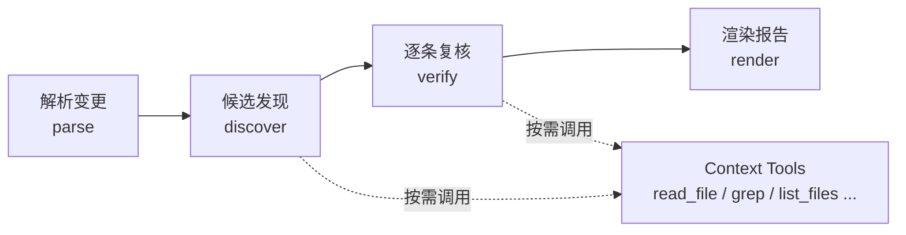
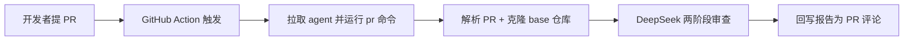

# Code Review Agent

一个面向本地 git 仓库的 AI 代码审查 Agent：读取变更 diff，先用 LLM 发现候选问题，再对每条候选逐一复核取证，最终输出 P0–P3 分级的 Markdown 审查报告。

审查不是「模型一次回答即结束」，而是**两阶段**：



- **候选发现**：模型阅读 diff，按需调用工具补足上下文，产出可定位的候选问题（文件、行号、严重性、触发条件、修复建议）。
- **逐条复核**：模型对每条候选重新取证，判定 `confirmed` / `downgraded` / `rejected`，重新给出严重性与置信度。只有成立的问题进入报告。

## 安装

要求 Node 22 与 pnpm（项目使用 ESM）。

```bash
pnpm install
```

开发与验证命令：

```bash
pnpm dev        # 以 tsx 直接运行 CLI
pnpm test       # vitest 全量测试（确定性 fake 模型，不访问网络）
pnpm typecheck  # tsc --noEmit
pnpm build      # 编译到 dist/
```

## 配置

```bash
cp .env.example .env
```

在 `.env` 中填入 DeepSeek API Key：

```dotenv
DEEPSEEK_API_KEY=sk-xxxxxxxx
```

可选项（均有默认值，通常无需设置）：

| 变量 | 默认值 | 说明 |
| --- | --- | --- |
| `DEEPSEEK_API_KEY` | 无（必填） | DeepSeek API Key；缺失时直接报配置错误退出 |
| `REVIEW_MODEL` | `deepseek-chat` | 模型名 |
| `REVIEW_BASE_URL` | `https://api.deepseek.com` | OpenAI 兼容端点；必须是 https 且不能内嵌用户名/密码 |
| `MAX_TOOL_STEPS` | `8` | 单个阶段（发现/每条复核）允许的工具调用轮数上限 |
| `MAX_FILES_PER_BATCH` | `20` | 单次送入模型的文件数上限，超出则按文件分批发现候选 |
| `GITHUB_TOKEN` | 无（可选） | GitHub API Token；公共仓库可匿名（约 60 次/小时限流），私有仓库或 `--comment` 回写必填；只读权限即可 |

**关于 `.env` 的读取位置（安全设计）**：`.env` 只从 **Agent 自身目录**（由 `src/index.ts` 所在位置经 `import.meta.url` 推导出的项目根目录）加载，**不会**从 `process.cwd()` 或 `--repo` 指向的被审仓库读取。这样即使被审仓库里投放了恶意 `.env`，也无法劫持 `DEEPSEEK_API_KEY` 或把请求改写到攻击者端点。因此请在 Agent 项目根目录放置 `.env`，而不是在被审仓库里。

## 使用

```text
用法：code-review-agent <diff|commit|branch|pr> [ref] [--base <ref>] [--repo <path>] [--comment <owner/repo#pr>]
```

| 命令 | 审查范围 | 说明 |
| --- | --- | --- |
| `diff` | 工作区未提交变更（`git diff HEAD`） | `--base` 仅作为元数据记录，不改变实际 diff 范围 |
| `commit <sha>` | 单个提交相对其父提交（`git show <sha>`） | 必须提供 commit sha；`--base` 对该命令无效 |
| `branch <name>` | `merge-base(base, name)..name` | `--base` 指定基准分支，默认 `main` |
| `pr <owner/repo> <pr>` | base...head 三圆点 diff | 解析 GitHub PR → 克隆 base 仓库 → 以 `branch` 范围审查；`--comment` 可回写 PR 评论 |

`--repo <path>` 指定被审仓库路径，默认 `process.cwd()`。

### 示例

```bash
# 输入：在项目目录直接运行，审查当前工作区相对 HEAD 的未提交改动
pnpm dev diff
```

```bash
# 输入：审查另一个仓库的工作区改动
pnpm dev diff --repo ../my-app
```

```bash
# 输入：审查某个提交引入的改动（相对其父提交）
pnpm dev commit 3f2a9c1 --repo ../my-app
```

```bash
# 输入：审查 feature/login 分支相对 main 的改动
pnpm dev branch feature/login --base main --repo ../my-app
```

> 本项目脚本用 pnpm 调用：参数直接写在脚本名后（`pnpm dev diff`）。不要额外加 `--`——pnpm 8 会把 `--` 原样传给脚本，CLI 会把它当成未知命令并打印用法。若改用 npm，则需写成 `npm run dev -- diff`。

审查结果直接打印到标准输出。空 diff 会短路、不调用模型，报告为「未发现明确问题」。

### 失败兜底（fail-closed）

如果审查链路无法完成（网络、鉴权、模型输出无法解析等），报告会明确写明**「无法充分审查」**、总体建议为「需要补充信息」，并在问题详情中说明「审查未完成，本次结果不可作为合并依据」。它**不会**把失败渲染成「未发现明确问题」。

## 报告示例

```markdown
# Code Review Report

## 1. 审查摘要

- 审查状态：发现问题
- 总体建议：可合并但建议改进
- 问题统计：P0 0 个 / P1 0 个 / P2 1 个 / P3 0 个（共 1 个）
- 审查范围：工作区 diff
- 验证限制：
  - 审查基于本地 git 仓库（PR/MR 由平台层克隆到本地后审查）

## 2. 问题详情

### [P2] divide 未处理除数为 0 的情况

- 文件：`src/parse.ts`
- 代码位置：`src/parse.ts:1`
- 问题类型：correctness
- 问题描述：divide() 在 b 为 0 时返回 Infinity，调用方未做校验。
- 触发条件：b === 0 时调用 divide
- 影响分析：下游计算得到 Infinity，可能导致展示或存储异常。
- 修复建议：在函数入口显式抛出错误或返回 Result 类型。
- 置信度：high
- 证据：src/parse.ts:1 `return a / b`，无除零分支。

## 3. 总结与后续建议

- 最需优先处理的问题：[P2] divide 未处理除数为 0 的情况（`src/parse.ts:1`）
- 建议补充的测试：建议为以下位置补充回归测试：`src/parse.ts:1`
- 需要人工确认的事项：无
```

严重性含义：P0 阻断、P1 严重、P2 一般、P3 轻微。报告总是包含「审查摘要 / 问题详情 / 总结与后续建议」三节；没有问题时如实输出「未发现明确问题」，不填充模板。

## 架构

| 模块 | 文件 | 职责 |
| --- | --- | --- |
| Agent Core | `src/core/graph.ts`、`src/core/state.ts` | LangGraph `StateGraph` 编排 `parse → discover → verify → render`，维护审查状态与失败兜底 |
| LLM Adapter | `src/llm/adapter.ts`（配套 `src/llm/schemas.ts`） | 用 `ChatOpenAI` 以 OpenAI 兼容协议调用 DeepSeek，温度 0；Zod schema 定义候选/复核/最终问题结构 |
| Repository Adapter | `src/repository/adapter.ts`、`src/repository/diff.ts` | `simple-git` 读取工作区/提交/分支 diff 与文件内容；把 unified diff 解析为平台无关的 `ChangeSet` |
| Context Tools | `src/tools/context-tools.ts` | 向模型暴露 `read_file`、`read_file_range`、`grep`、`list_files`、`read_related_test` 五个按需取证工具 |
| Review Engine | `src/review/engine.ts`（配套 `src/review/grade.ts`） | 两阶段提示词与工具调用循环；合并候选与复核结果、丢弃 rejected、去重与排序 |
| Report Generator | `src/report/generator.ts` | 把结构化结果渲染为三节式 Markdown 报告，转义自由文本中的 HTML 字符 |
| Platform Integration | `src/platform/types.ts` | 预留 `PlatformAdapter` 接口（`postReviewComment`），Phase 1 无实现 |

变更文件数超过 `MAX_FILES_PER_BATCH` 时会按批发现候选，并为每批候选 id 加 `b<批次>-` 前缀，避免跨批 id 冲突导致复核错配。

## 接入真实 GitHub 仓库（提 PR 自动审查）

仓库已内置 GitHub Action 模板 `.github/workflows/ai-review.yml`：目标仓库有人提 PR（`opened` / `synchronize` / `reopened`）时，Action 自动拉取本 Agent、运行 `pr` 命令审查该 PR，并把 Markdown 报告回写为该 PR 的评论。



### 接入步骤（目标仓库侧）

1. **复制 workflow**：把本仓库的 `.github/workflows/ai-review.yml` 复制到目标仓库的 `.github/workflows/` 目录。
2. **改占位符**：把文件里的 `<agent-repo>` 替换为本 Agent 的 GitHub 地址（如 `your-name/code-review-agent`）。若 Agent 已发布到 npm，可改为 `npx code-review-agent pr ...`。
3. **配置密钥**：在目标仓库 Settings → Secrets and variables → Actions 新增 secret `DEEPSEEK_API_KEY`（DeepSeek API Key）。`GITHUB_TOKEN` 无需配置——workflow 用 GitHub 内置的 `${{ github.token }}`。

完成上述三步后，目标仓库的每个 PR 都会自动触发审查并回写评论。

### 本地手动验证（不依赖 Action）

```bash
# 输入：审查 owner/repo 的第 7 号 PR，并把报告回写为该 PR 评论
pnpm dev pr owner/repo 7 --comment owner/repo#7
```

`--comment` 需要 `GITHUB_TOKEN` 有该仓库的评论写入权限；不加 `--comment` 则只打印报告、不回写。

### 注意事项

- **fork PR 回写受限**：workflow 用 `pull_request` 事件，此时 GitHub 内置 `github.token` 对 fork PR 只有只读权限，无法回写评论（同仓库 PR 正常）。要支持 fork PR 回写，需改用 `pull_request_target` 事件或另配一个有写权限的 PAT，并额外评估安全风险。
- **fork PR 的 head 拉取**：按 SHA 拉取 fork 的 head，依赖 GitHub 端 `uploadpack.allowReachableSHA1InWant`（经 `refs/pull/N/head` 可达）。
- **私有仓库**：`resolvePullRequest` 与 `clonePullRequest` 需 `GITHUB_TOKEN` 鉴权；workflow 已注入 `${{ github.token }}`，手动运行时需自行 `export GITHUB_TOKEN=...`。

## 扩展点

### 接入 GitHub / GitLab / Gitea

GitHub 已实现，GitLab / Gitea 待扩展：

- **读侧**：`src/platform/github.ts` 的 `resolvePullRequest` 解析 PR（拿 base/head sha 与 base 仓库 clone URL），`clonePullRequest` 克隆 base 仓库并按 sha 拉取 base/head，不执行被审仓库代码。
- **写侧**：`GitHubPlatformAdapter` 实现 `PlatformAdapter.postReviewComment(reviewId, body)`，把 Markdown 报告回写为 PR 评论。
- **触发侧**：`.github/workflows/ai-review.yml` 是 GitHub Action 模板，提 PR 时自动运行 `pr` 命令并回写评论。
- 其他平台按同一接口各自实现一个适配器：平台侧数据在适配器内转换为核心统一的 `ChangeSet`（`src/repository/diff.ts`），核心审查逻辑不感知平台专有字段。

### 替换模型

- 修改 `src/llm/adapter.ts` 中的 `createReviewModel`，或通过 `REVIEW_MODEL` / `REVIEW_BASE_URL` 指向任意 OpenAI 兼容端点。
- 不更换供应商时只需改环境变量；更换协议时替换 `createReviewModel` 即可，`Review Engine` 只依赖 LangChain 的 `ChatOpenAI` 接口。

## 当前限制

- **无 Webhook 服务**：触发靠 GitHub Action（`.github/workflows/ai-review.yml`），未提供常驻 Webhook 接收器。
- **无 auto-merge / auto-fix**：写侧仅回写审查评论，不自动合并、不自动修改源码。
- **fork PR 的 head 拉取**：按 SHA 拉取 fork 的 head，依赖 GitHub 端开启的 `uploadpack.allowReachableSHA1InWant`（经 `refs/pull/N/head` 可达）。
- **匿名访问限流**：公共仓库可匿名调用 GitHub API（约 60 次/小时），超出或私有仓库需配置 `GITHUB_TOKEN`。
- **测试不触发真实模型**：`pnpm test` 使用确定性的 fake 模型，覆盖流程、解析、复核合并与报告渲染，但不验证真实 LLM 的审查质量与网络行为。
- **语言范围**：提示词优先针对 TypeScript/JavaScript；其他语言可运行但效果未经验证。
- **diff 解析边界**：二进制文件会被跳过；路径含字面 ` b/` 子串等极端情况受 unified diff 格式固有歧义影响。
