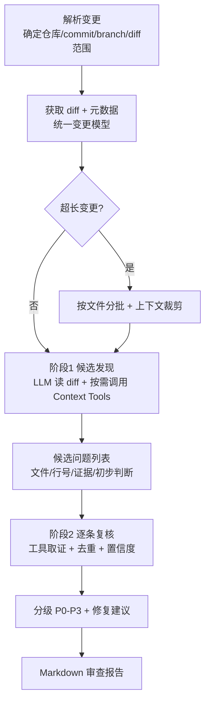

# Code Review Agent 设计文档

- 日期：2026-10-26
- 状态：待批准
- 相关技能：brainstorming（已确认需求）→ writing-plans（批准后）

## 1. 意图与动机（Why）

构建一个**真实可用**的 AI Code Review Agent：在代码合并前，自动分析 git 变更，识别潜在缺陷，输出专业、可执行的 Markdown 审查报告。

两个层次的动机：

1. **当下**：先做出一个能真跑、能真审真实代码的工具，不是演示玩具。
2. **后续**：把它沉淀成面试叙事——「我为什么把这个 Agent 设计成这样」（为什么用 LangGraph、为什么两阶段、为什么按需取上下文、为什么平台/模型解耦）。

## 2. 目标 / 非目标 / 反目标

### 目标（Phase 1 必须达成）

- 通过本地 git diff / commit / branch 触发审查。
- 获取变更的 diff、文件路径、变更行号、必要上下文。
- 用 LLM 分析变更，识别逻辑缺陷、安全风险、性能、并发、兼容性、测试不足等问题。
- 按需调用工具（读文件、搜索代码、读测试）获取上下文，而不是一次性塞入整个仓库。
- 候选问题二次复核，降低误报。
- P0–P3 分级 + 具体修复建议。
- 输出规范 Markdown 报告，明确审查范围与验证限制。
- 模块化：核心审查逻辑与代码托管平台、模型供应商解耦。

### 非目标（Phase 1 不做）

- 不接入真实 GitHub / GitLab / Gitea 平台写评论（只留接口）。
- 不自动合并、不自动修改源代码、不强制阻止合并。
- 不做 Web 服务 / 常驻进程 / CI 集成（后续再考虑）。

### 反目标（做了反而算失败）

- 不为了凑审查发现数量而制造问题。
- 不把「模型一次回答」当成「完成审查」——必须有工具调用 + 复核流程。
- 不把 GitHub / GitLab 专有字段写进核心审查逻辑。

## 3. 约束（已确认）

- 语言：TypeScript（ESM），Node 22，pnpm。
- 编排：LangGraph（`@langchain/langgraph`）。
- 模型：DeepSeek（默认 `deepseek-chat`），通过 `@langchain/openai` 的 ChatOpenAI 指向 DeepSeek 的 OpenAI 兼容 baseURL。
- 模型名 / 地址 / key 全部走配置，不硬编码在源码。
- 数据模型：Zod。
- 测试：vitest（用确定性 mock 模型，不依赖真实 key）。
- git 读取：`simple-git`。
- 认证：`DEEPSEEK_API_KEY` 从环境变量读取，不进源码、不进仓库。

## 4. 已定的设计决策（用户拍板或已确认）

- **TypeScript + LangGraph**（用户指定，替代了我最初建议的 Python 手写 loop）。
- **DeepSeek** 作为默认模型（用户指定，用户已提供可用 key）。
- **无指定仓库**：自建一个内置测试仓库（预埋已知 bug），用于可复现验证和演示。
- **第一阶段只做本地入口**，不做平台写操作。
- **审查语言范围：TS/JS 优先**（用户指定）。提示词内置 JS/TS 特定陷阱（事件循环、类型、闭包、包依赖）；内置测试仓库预埋 TS bug；提示词结构保持可扩展，未来可加其他语言。
- **验收标准**：以「不误报」为底线、兼顾召回——预埋 bug 命中大部分，但绝不编造；证据不足标「待确认」而非「问题」。
- **入口语义**：`diff`＝未提交工作区（`git diff HEAD`）或两 ref 之间；`commit`＝单提交相对其父提交；`branch`＝`merge-base(main, 分支)..分支`，默认 base `main`。
- **阶段二复核主体**：LLM + 工具逐条复核（非纯脚本），设工具调用上限防失控循环；脚本只做去重与格式化。

## 5. 架构模块

七个职责模块（对应任务书），Phase 1 的实际落地方式：

1. **Agent Core**：LangGraph 状态图，编排审查任务、状态流转。
2. **LLM Adapter**：封装模型调用（ChatOpenAI → DeepSeek），业务层不感知供应商。
3. **Repository Adapter**：统一仓库读取与变更获取；Phase 1 只实现本地 git，未来加 GitHub/GitLab/Gitea。
4. **Context Tools**：`read_file` / `grep` / `list_dir` / `read_at_revision` / `read_test` 等，以 function calling 暴露给模型。
5. **Review Engine**：候选发现 + 复核验证 + 严重程度分级。
6. **Report Generator**：结构化结果 → Markdown 报告。
7. **Platform Integration**：预留评审评论发布接口（读/写权限分离，默认只读），Phase 1 不实现真实写操作。

## 6. Agent 执行流程（LangGraph StateGraph）



节点职责与「Agent 能力」对应：

1. **解析变更**：确定审查范围，检查输入是否完整，识别缺失上下文。
2. **候选发现**：按文件/功能分析新增、修改、删除代码；理解调用关系、数据流；选择值得深入的风险点（非机械清单）。
3. **复核验证**：由 LLM + 工具逐条复核（设工具调用上限），核实——是否真实存在、是否本次变更引入、触发条件、实际影响、是否与已发现重复；证据不足则降置信度或剔除。
4. **分级报告**：P0–P3 分级，附修复建议与示例代码，输出 Markdown。

## 7. 统一内部变更模型（Zod schema 概览）

平台无关的中间模型，所有平台数据先转成它，核心逻辑只认它：

- `ChangeSet`：`{ meta, files: FileChange[] }`
- `FileChange`：`{ path, status: added|modified|deleted|renamed, oldPath?, hunks: Hunk[] }`
- `Hunk`：`{ header, lines: DiffLine[], newStartLine }`
- `DiffLine`：`{ type: add|del|context, oldLine?, newLine?, content }`
- `Finding`：`{ id, title, severity: P0|P1|P2|P3, file, line, category, description, trigger, impact, suggestion, confidence, verified }`
- `ReviewReport`：`{ status, overallVerdict, stats, findings: Finding[], scope, limitations }`

## 8. 报告结构

按任务书第五章：

```
# Code Review Report
## 1. 审查摘要（状态 / 总体建议 / P0-P3 统计 / 范围与限制）
## 2. 问题详情（[P1] 标题 + 文件 + 位置 + 类型 + 描述 + 触发条件 + 影响 + 修复建议 + 示例）
## 3. 总结与后续建议（优先处理 / 建议测试 / 人工确认）
```

没有明确问题时如实报告「未发现明确问题」，不填充模板。

## 9. 验证方式

- **单元测试**：mock 模型 + 内置测试仓库的预埋 bug，断言能发现并正确分级。
- **集成测试**：真实 git diff → 完整 pipeline → 报告生成。
- **真实端到端**：用 DeepSeek key 跑一次，人工核对报告质量。
- **通过判据**：预埋 bug 命中大部分（召回）；无编造问题（精确）；证据不足标「待确认」。
- 不虚构测试结果；未验证的功能明确标注。

## 10. 留给实现者（builder）的决策

以下可由实现者自行决定，不影响「建什么」，无需再问用户：

- 具体目录 / 文件命名、包结构。
- LangGraph 状态图的精确节点 / 边实现（两阶段用子图还是条件边表达）。
- Context Tools 的具体集合与参数。
- 超长 diff 的分批阈值与裁剪策略。
- 测试夹具仓库的 bug 清单（预埋哪些已知缺陷）。
- 错误处理、日志、CLI 参数设计等工程细节。
